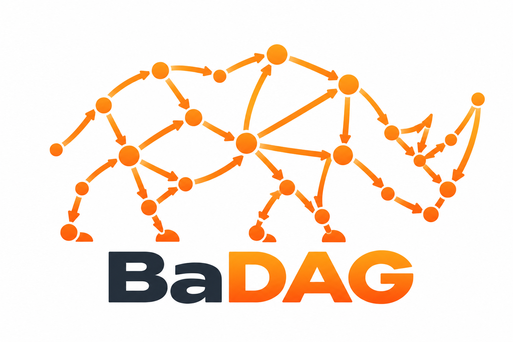
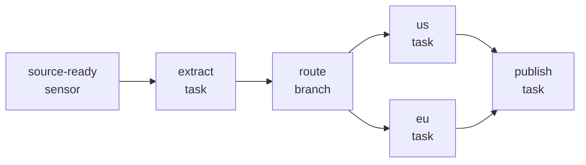

<!-- Logo lives at ./logo.png beside this README. -->
<p align="center">
  
</p>

<h1 align="center">Badag</h1>

<p align="center">
  <strong>DAGs that typecheck.</strong><br />
  Declare tasks, wire dependencies, and catch broken graphs before runtime.
</p>

<p align="center">
  
  
  
</p>

Badag is a small TypeScript SDK for describing task graphs. It borrows
Airflow's vocabulary — tasks, sensors, delays, branches, short-circuits,
triggers — and makes the graph a typed value you can validate, serialize, and
hand to a runtime of your choice.

> **The graph is the code. The compiler checks the edges.**

## Install

```sh
bun add @badag/sdk
```

The SDK is ESM-only, ships declaration files, and bundles `@badag/core`, so
there is one package to install and no execution engine hiding inside. Using
npm or pnpm? `npm install @badag/sdk` and `pnpm add @badag/sdk` work too.

## A graph in 30 seconds

A daily pricing job: wait for the vendor drop, extract prices, route by region,
and publish after the selected region finishes.



```ts
import { branch, createDAG, sensor, task } from "@badag/sdk";

const sourceReady = sensor("source-ready", {
    predicate: async () => (await fetch("https://example.com/prices")).ok,
    pokeIntervalMs: 60_000,
    description: "Wait for the vendor drop",
});

const extract = task("extract", {
    fn: async () => (await fetch("https://example.com/prices")).json(),
});

const route = branch("route", {
    branches: ["us", "eu"],
    choose: () => (process.env.REGION === "eu" ? "eu" : "us"),
});

const us = task("us", { fn: () => "priced US" });
const eu = task("eu", { fn: () => "priced EU" });
const publish = task("publish", { fn: () => "published" });

const pricing = createDAG("daily-pricing")
    .chain(sourceReady, extract, route)
    .chain(route, [us, eu]) // must name exactly the declared branches
    .chain([us, eu], publish);

pricing.validate(); // [] — acyclic, consistent, every branch routed
pricing.toJSON(); // plain JSON: names, kinds, trigger rules, edges
```

That's the whole idea. The SDK stores the wiring; your scheduler reads `kind`,
`triggerRule`, `upstream`, and `downstream` and decides what actually runs.

Wiring is all-or-nothing: if one edge in a batch is invalid, the call adds
neither tasks nor edges. Repeating the same wiring is idempotent, so composed
builders stay safe.

## Why Badag?

- **The compiler checks the graph.** When you keep the DAG returned by
  `chain()`, its type remembers the tasks and edges added so far. Cycles,
  self-dependencies, duplicate names, and routing steps that miss or invent a
  declared branch become compile-time errors. The static check covers `chain()`
  calls with up to 40 wiring sets; runtime validation covers everything else,
  including dynamically assembled graphs.

- **Transactional, idempotent wiring.** Every batch validates before it
  commits. A rejected edge leaves the task registry and edge list unchanged,
  and re-running an existing chain does nothing.

- **Airflow familiarity without the platform.** Six task kinds, wiring sets for
  fan-out and fan-in, and Airflow-style `>>`/`<<` bitshift expressions. No YAML,
  no webserver, no scheduler to operate.

- **Validation that reports instead of throws.** `validate()` returns a
  read-only list of `{ code, subjects, message }` findings and never throws.
  The codes are a closed set, ready for exhaustive switches in a CI check, API,
  or graph-rendering UI.

- **Typed payloads from schemas you already use.** `input` types `ctx.payload`;
  `output` types the produced value. Any Standard Schema works — Zod, Valibot,
  ArkType, or your own. Badag stores the schemas and leaves validation timing
  to the runtime.

- **Stable, content-derived task IDs.** A task ID is a synchronous 128-bit
  FNV-1a hash of the task name and behavior source. Metadata changes do not
  churn IDs, and the same definition shares an ID across DAGs. The hash uses
  only platform APIs, so it behaves the same in Node, Bun, browsers, and
  Cloudflare Workers.

- **Snapshots for free.** `dag.toJSON()` gives you names, IDs, kinds, trigger
  rules, and edges by name — ready for storage, an API response, or drawing the
  graph in a UI. Callbacks are omitted, so the snapshot is for inspection, not
  rehydration.

## Task kinds

Every factory accepts optional `description`, `config`, `triggerRule`, and
Standard Schema `input`/`output`. The kind-specific fields are declared here and
honored by your runtime.

| Factory | `kind` | Stored behavior | Scheduler's move |
| --- | --- | --- | --- |
| `task` | `task` | `fn` | call the callback |
| `sensor` | `sensor` | `predicate`, `pokeIntervalMs?` | poll until the predicate returns true |
| `delay` | `delay` | `durationMs` | wait |
| `branch` | `branch` | `choose`, optional `branches` | run the chosen branch names |
| `shortCircuit` | `short_circuit` | `condition` | gate downstream work |
| `trigger` | `trigger` | `dagName`, `waitForCompletion` | start another DAG |

`triggerRule` defaults to `all_success`; the full set of rules is documented in
the [core README](packages/core/README.md#trigger-rules).

## Bring your own runtime

Badag describes; it does not execute. It never invokes your callbacks and
stores no ready, running, completed, or failed state. Your scheduler owns
readiness, retries, persistence, and observability, which keeps the graph
portable and the library predictable.

```ts
for (const registered of pricing.topologicalSort()) {
    console.log(registered.name, registered.definition.kind);
}
```

The same graph can be validated in CI, stored as JSON, rendered in an admin UI,
and executed by a worker — without any of them sharing scheduler internals.

## Documentation

- [`packages/core/README.md`](packages/core/README.md) — full API: task kinds,
  wiring, validation, serialization, and errors.
- [`packages/sdk/README.md`](packages/sdk/README.md) — the public
  `@badag/sdk` entry point.
- [`GLOSSARY.md`](GLOSSARY.md) — the language used across the codebase.
- [`docs/adr/`](docs/adr) — architecture decision records.

## Repository

| Path | What it holds |
| --- | --- |
| `packages/core` | DAG builder, task factories, audit rules, hashing, serialization |
| `packages/sdk` | Public `@badag/sdk` package; bundles core for publishing |
| `packages/db-schema` | Drizzle schemas for the app |
| `apps/app` | Hono API on Cloudflare Workers |
| `docs/adr` | Architecture decision records |

## Development

```sh
bun install
bun run test
bun run check
bun run build
```

`bun run check` runs the Ultracite lint and format checks; `bun run fix` applies
the fixes.

## License

MIT
