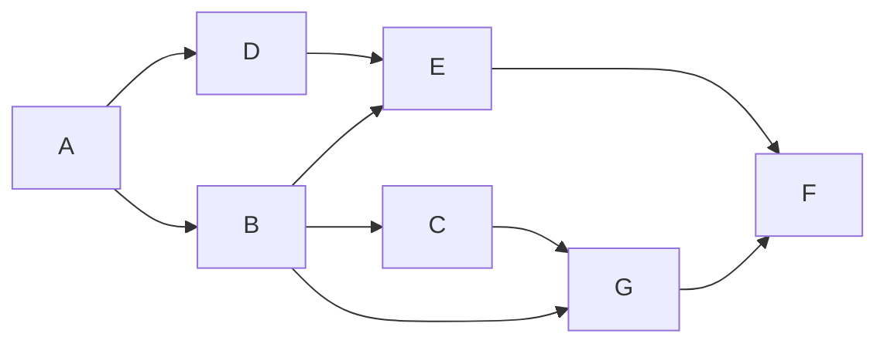

# @badag/sdk

An Airflow-inspired DAG builder for TypeScript. Declare tasks, wire dependencies, then read back a topological order or poll which tasks are ready to run.

- ESM-only, zero runtime dependencies.
- Every edge inserted through the public methods is validated, so a `DAG` cannot become cyclic or cross DAG boundaries.
- Task names stay literal types; graph links are `ReadonlySet`, so they cannot be mutated by accident.

## Install

```sh
# bun
bun add @badag/sdk

# npm
npm install @badag/sdk

# pnpm
pnpm add @badag/sdk

# yarn
yarn add @badag/sdk
```

The package ships ESM only (`dist/index.mjs`), so use `import` rather than `require`. It has no runtime dependencies, and the published bundle is a single self-contained module that bundles cleanly for Cloudflare Workers.

## Import

```ts
import { DAG, TRIGGER_RULE_ENUM, crossDownstream, task } from "@badag/sdk";
```

Types come from the same entry point:

```ts
import type {
    DAGJson,
    DAGTask,
    CreateTask,
    TaskConfig,
    TaskContext,
    TaskFn,
    TaskJson,
    TaskLike,
    TaskOrTasks,
    TaskParamInput,
    TaskParamOutput,
    TriggerRule,
} from "@badag/sdk";
// or inline, mixing values and types:
import { DAG, type DAGTask, task } from "@badag/sdk";
```

## Quick start

The example below builds this graph:



```ts
import { DAG, task } from "@badag/sdk";

const a = task("A", {
    fn: async (ctx) => `${ctx.name}: extracted`,
});
const b = task("B", {
    fn: async (ctx) => `${ctx.name}: normalized`,
});
const c = task("C", {
    fn: async (ctx) => `${ctx.name}: aggregated`,
});
const d = task("D", { fn: async (ctx) => `${ctx.name}: joined` });
const e = task("E", { fn: async (ctx) => `${ctx.name}: scored` });
const f = task("F", {
    fn: async (ctx) => `${ctx.name}: published`,
});
const g = task("G", { fn: async (ctx) => `${ctx.name}: archived` });

const dag = new DAG("example")
    .chain(a, [d, b])
    .chain(d, e)
    .chain(b, [e, c, g])
    .chain(c, g)
    .chain(e, f)
    .chain(g, f);

for (const task of dag.topologicalSort()) {
    console.log(task.name, await task.fn({ id: task.id, name: task.name }));
}
```

`A` runs first and `F` last; every other task waits for its upstream tasks. The array from `topologicalSort()` for this graph is `["A", "D", "B", "E", "C", "G", "F"]`.

## Declaring tasks

Task definitions come from `task()`; `chain()` registers them in the DAG as it links wiring sets:

```ts
import { DAG, task } from "@badag/sdk";

const extract = task("extract", {
    fn: () => fetch("https://example.com/data").then((res) => res.text()),
    description: "Fetch the source dataset",
    config: { timeout_ms: 30_000 },
});
const load = task("load", { fn: () => "stored" });

const dag = new DAG("etl").chain(extract, load);
```

Every task callback receives its task context as the first argument. The context contains the registered task's ID and its literal name:

```ts
const report = task("report", {
    fn: (ctx) => `${ctx.id}:${ctx.name.toUpperCase()}`,
});

const dag = new DAG("etl").chain(report);
const task = dag.getTask("report");

if (task !== undefined) {
    await task.fn({ id: task.id, name: task.name }); // "<task-id>:REPORT"
}
```

A `task()` definition has no ID; the ID exists once the definition is registered as a `DAGTask`.

- `chain()` registers every definition it encounters before linking. Definitions already registered in the DAG are reused, so repeated calls are idempotent; invalid duplicates and cycles are rejected at compile time when the returned DAG is kept.
- Every batch is transactional: a task name collision, duplicate task ID, self-edge, cross-DAG edge, or cycle leaves both the task registry and the edges unchanged.
- A single wiring set registers without adding edges, which is how isolated tasks are declared: `dag.chain([extract, load])`.
- `addDependency()`, `addDependencies()`, `setUpstream()`, `setDownstream()`, and `dependsOn()` also register definitions on first use.
- The first argument is the task name. It is trimmed, must be unique inside the DAG, and is preserved as a literal type: `"  extract  "` becomes `"extract"`. Words may be joined with `-` or `_`; other separators are rejected.
- `fn` receives `{ id, name }` as its first argument; the DAG never calls it. `id` is assigned when the definition is registered.
- `triggerRule` defaults to `all_success`; the SDK stores it for the scheduler and does not evaluate it.
- `description` is an optional human-readable string stored verbatim on the definition and registered task.
- `config` is stored verbatim on the registered task; the SDK does not interpret it.

### Trigger rules

`triggerRule` is available on the definition and on the registered task. It records when the scheduler may run the task, but the SDK does not evaluate it yet. The exported `TRIGGER_RULE_ENUM` provides the values as an enum-like object.

| Rule | Meaning |
| --- | --- |
| `all_success` | All upstream tasks succeed. The default. |
| `all_done` | All upstream tasks reach a terminal state, regardless of outcome. |
| `one_success` | At least one upstream task succeeds; the task may run before the others finish. |
| `one_failed` | At least one upstream task fails; the task may run before the others finish. |
| `none_failed` | All upstream tasks finish with no failures; skipped upstreams are allowed. |
| `none_failed_min_one_success` | All upstream tasks finish, none fail, and at least one succeeds. |
| `all_skipped` | All upstream tasks are skipped. |

```ts
import { task, TRIGGER_RULE_ENUM } from "@badag/sdk";

const report = task("report", {
    fn: () => "done",
    triggerRule: TRIGGER_RULE_ENUM.AllDone,
});

report.triggerRule; // "all_done"
```

### Reusing a definition

`task()` builds a task definition outside any DAG. Its name is trimmed and validated there; a task ID is assigned only when the definition is registered as a `DAGTask`. That task ID is a synchronous 128-bit FNV-1a hash over the task name and function source (`fn.toString()`), computed in plain JavaScript, so the same name and source always produce the same task ID, and changing either changes the task ID. The hash uses only standard platform APIs (`TextEncoder` and `BigInt`), so it behaves identically in Node, Bun, browsers, and Cloudflare Workers. Closure values, `description`, `config`, and `triggerRule` are not hashed. Register the definition wherever you need it — each `DAG` tracks its own names and task IDs:

```ts
import { task } from "@badag/sdk";

const nightly = task("cleanup", { fn: () => removeStaleRows() });

const etl = new DAG("etl").chain(nightly);
const audit = new DAG("audit").chain(nightly);
```

### Lookup

```ts
dag.getTask("extract"); // DAGTask<"extract"> | undefined
dag.tasks; // ReadonlyMap<string, DAGTask>, keyed by name
```

## Wiring dependencies

An edge points from an upstream task to a downstream task. With `a` and `b` as registered `DAGTask` handles, all of these add `a -> b`:

```ts
a.setDownstream(b);
b.setUpstream(a);
b.dependsOn(a); // alias for setUpstream()
dag.addDependency(a, b);
dag.addDependencies([a, b], [c, d]); // a -> c, a -> d, b -> c, b -> d
```

Handles come from `dag.getTask()` or from execution helpers such as `topologicalSort()` and `getReadyTasks()`. Definitions work anywhere a handle does; edge methods register them on first use.

Wiring sets link every member of one set to every member of the next. `chain()` registers definitions before linking; `crossDownstream()` takes handles only:

```ts
dag.chain(a, [b, c], d); // a -> b, a -> c, b -> d, c -> d
crossDownstream([a, b], [c, d]); // a -> c, a -> d, b -> c, b -> d
```

`chain()` returns the DAG, so calls compose. Each wiring set is normalized once, definitions are validated and registered before any edge is added, and already-linked edges are skipped, so repeated calls are idempotent. Every batch is all-or-nothing: if any edge is rejected, the call adds neither tasks nor edges. `crossDownstream()` is the free-function form for full bipartite linking and delegates to `addDependencies()`.

### Chaining patterns

Pass each task or wiring set as a separate argument. Multiple plain tasks form a linear chain in one call:

```ts
const extract = task("extract", { fn: () => "raw" });
const transform = task("transform", { fn: () => "clean" });
const load = task("load", { fn: () => "stored" });

const dag = new DAG("etl").chain(extract, transform, load);
// extract -> transform -> load
```

An array between plain tasks fans out to the array and fans in from it:

```ts
const extract = task("extract", { fn: () => "raw" });
const cleanA = task("cleanA", { fn: () => "cleanA" });
const cleanB = task("cleanB", { fn: () => "cleanB" });
const join = task("join", { fn: () => "joined" });
const validate = task("validate", { fn: () => "valid" });
const publish = task("publish", { fn: () => "published" });

const dag = new DAG("etl").chain(
    extract,
    [cleanA, cleanB],
    join,
    validate,
    publish
);
// extract -> cleanA, extract -> cleanB
// cleanA -> join, cleanB -> join
// join -> validate -> publish
```

A handle repeated inside one wiring set adds only one edge. An empty wiring set is a no-op, so it leaves the sets on either side disconnected:

```ts
new DAG("etl").chain(extract, [], publish); // no extract -> publish edge
```

Separate `chain()` calls are independent: each call adds only the edges inside that call, and no edge is added between calls.

```ts
new DAG("etl").chain(a, b).chain(c, d);
// a -> b and c -> d; no b -> c edge
```

To build one continuous four-task chain, pass all tasks to a single call or share boundary tasks between calls:

```ts
new DAG("etl").chain(a, b, c, d);
new DAG("etl").chain(a, b).chain(b, c).chain(c, d);
// both: a -> b -> c -> d
```

Wiring set boundaries do not weaken validation: self edges, cycles across wiring sets, invalid duplicate definitions, and handles from another DAG are rejected.

### Compile-time chain checks

`DAG` carries the definitions and edges added by `chain()` in its type, so invalid chains fail to typecheck:

```ts
const a = task("a", { fn: () => "a" });
const b = task("b", { fn: () => "b" });
const c = task("c", { fn: () => "c" });

const dag = new DAG("etl").chain(a, b, c);

dag.chain(c, a); // error: dependency "c" -> "a" creates a cycle
dag.chain(b, b); // error: task "b" cannot depend on itself

const duplicate = task("a", { fn: () => 1 });
dag.chain(duplicate); // error: task "a" already exists in DAG "etl"
```

- The type-level duplicate-definition check compares task names and inferred function signatures. Re-passing the same definition is allowed because runtime registration is idempotent; a same-name definition with a different function type is rejected.
- Adjacent wiring sets that share a task are rejected as self-edges.
- Cycles are found by walking the edges tracked in the DAG type.
- Static checks run for `chain()` calls with up to 40 positional wiring sets. Larger calls compile but are runtime-checked only, and their definitions and edges are not added to the DAG type state.
- The checks follow the value returned by `chain()`. If the result is discarded (`dag.chain(a, b);`), later calls are runtime-checked only. `addDependency()`, `addDependencies()`, `setUpstream()`, `setDownstream()`, and `crossDownstream()` are likewise runtime-checked.
- Generic helpers that widen task names or DAG state to `string` skip the static checks and rely on runtime validation.
- Handles from `getTask()`, `topologicalSort()`, and `getReadyTasks()` carry the generic `TaskFn`, so they add edges but no signatures; type-level duplicate detection compares definitions, while runtime remains authoritative for handle-only wiring.
- Two definitions with the same name and the same inferred function type but different function source cannot be distinguished statically; runtime still rejects them.

Edge methods accept either a `DAGTask` handle or a definition; an unseen definition is registered in this DAG, then resolved by task ID. `addDependencies()` links every upstream task to every downstream task. `crossDownstream()` is the exception and takes handles only.

Read links through `task.upstream` and `task.downstream` (both `ReadonlySet<DAGTask>`), and change them only through the methods above so validation still runs. Every edge insertion rejects:

- tasks that belong to a different DAG,
- a task depending on itself,
- an edge that would create a cycle.

Failed batches are rolled back, so `topologicalSort()` is total for graphs built through the typed public methods.

## Running tasks

The SDK only describes the graph; your scheduler decides how tasks execute. Sequential:

```ts
for (const task of dag.topologicalSort()) {
    await task.fn({ id: task.id, name: task.name });
}
```

Parallel, polling readiness with the set of completed **task IDs**:

```ts
const completed = new Set<string>();

while (true) {
    const ready = dag.getReadyTasks(completed);

    if (ready.length === 0) {
        break;
    }

    await Promise.all(
        ready.map(async (task) => {
            await task.fn({ id: task.id, name: task.name });
            completed.add(task.id);
        })
    );
}
```

`getReadyTasks()` is pure: it returns tasks that are not in `completed` and whose upstream tasks are all in `completed`. It does not remember previous calls.

## Serialization

`dag.toJSON()` returns a `DAGJson` snapshot: the DAG name, every task in registration order, and each task's edges as **task names**. Each entry is a `TaskJson`.

```ts
import { DAG, task } from "@badag/sdk";

const extract = task("extract", {
    fn: () => "raw",
    description: "Read source data",
});
const load = task("load", { fn: () => "stored" });

const dag = new DAG("etl").chain(extract, load);

dag.toJSON();
// {
//     name: "etl",
//     tasks: [
//         {
//             id: "…",
//             name: "extract",
//             triggerRule: "all_success",
//             description: "Read source data",
//             upstream: [],
//             downstream: ["load"],
//         },
//         {
//             id: "…",
//             name: "load",
//             triggerRule: "all_success",
//             upstream: ["extract"],
//             downstream: [],
//         },
//     ],
// }
```

- `id` is the registered task's task ID; `name` is unique within the DAG.
- `triggerRule` is always included and defaults to `all_success`.
- `upstream` and `downstream` list task names, in the order the edges were inserted.
- `description` is included when the task has one.
- `config` is included when the task has one.
- `fn` is omitted, so the snapshot is an inspection format, not a round-trip format. Rebuild a runnable DAG with `task()` and `chain()`.

`JSON.stringify(dag)` calls `toJSON()` automatically:

```ts
const encoded = JSON.stringify(dag); // same shape as dag.toJSON()
```

Grouped chains serialize with edges listed by name in both directions:

```ts
const grouped = new DAG("etl").chain(
    task("extract", { fn: () => "raw" }),
    [task("cleanA", { fn: () => "a" }), task("cleanB", { fn: () => "b" })],
    task("join", { fn: () => "joined" })
);

grouped.toJSON().tasks.map(({ name, upstream, downstream }) => ({
    name,
    upstream,
    downstream,
}));
// [
//     { name: "extract", upstream: [], downstream: ["cleanA", "cleanB"] },
//     { name: "cleanA", upstream: ["extract"], downstream: ["join"] },
//     { name: "cleanB", upstream: ["extract"], downstream: ["join"] },
//     { name: "join", upstream: ["cleanA", "cleanB"], downstream: [] },
// ]
```

`config` keeps the same object the task stores, so it must be JSON-serializable for `JSON.stringify()` to succeed — `BigInt` or circular values throw during stringification, not during `toJSON()`.

## API

| Export | Kind | Summary |
| --- | --- | --- |
| `DAG` | class | `name`, `tasks`, `getTask()`, `addDependency()`, `addDependencies()`, `chain()`, `topologicalSort()`, `getReadyTasks()`, `toJSON()` |
| `DAGTask` | type | Registered task handle; `id`, `name`, `fn`, `description`, `config`, `triggerRule`, `upstream`, `downstream`, `setUpstream()`, `setDownstream()`, `dependsOn()`. Minted by `DAG`, not constructible by consumers |
| `task` | function | Creates a `TaskParamOutput` from a name and input; trims and validates the name, and assigns no task ID |
| `crossDownstream` | function | Links every task of one list to every task of another |
| `TaskFn` | type | `(ctx: TaskContext<Name>) => unknown` — task callback signature |
| `TaskContext` | interface | `{ readonly id, readonly name }` passed as the first callback argument; `id` is the registered task ID |
| `TaskConfig` | interface | `timeout_ms` plus arbitrary keys, stored untouched |
| `TaskParamInput` | interface | `{ fn, description?, config?, triggerRule? }` — input to `task()` after the name |
| `TaskParamOutput` | interface | `TaskParamInput` plus `name` and the normalized `triggerRule`; ids live on registered `DAGTask`s |
| `TriggerRule` | type | `all_success`, `all_done`, `one_success`, `one_failed`, `none_failed`, `none_failed_min_one_success`, `all_skipped` |
| `TRIGGER_RULE_ENUM` | object | Enum-like map of the supported trigger rules |
| `TaskLike` | type | A `DAGTask` or a task definition returned by `task()` |
| `TaskOrTasks` | type | `TaskLike \| readonly TaskLike[]` |
| `TaskJson` | interface | `{ id, name, triggerRule, description?, config?, upstream, downstream }`; edges are task names |
| `DAGJson` | interface | `{ name, tasks }` returned by `toJSON()` |
| `CreateTask` | type | Call signature of `task(name, input)` |

## Types

- Task callbacks receive `{ id, name }` first; `id` is assigned when the definition is registered, and `task()` trims surrounding whitespace and infers `ctx.name` as the resulting literal name.
- Task names contain letters or numbers, with words joined by a single `-` or `_`; internal spaces, other punctuation, leading/trailing separators, and repeated separators are rejected.
- `task()` keeps the callback signature on the definition, including its context parameter and return type; zero-argument callbacks remain assignable when the context is unused.
- `task()` adds `triggerRule: "all_success"` when the input omits it; registered tasks expose the normalized value.
- `description` is optional on task definitions and registered tasks, and is included in `toJSON()` when present.
- `TaskFn` is `(ctx: TaskContext<Name>) => unknown`; `PromiseLike` results are allowed and are not awaited by the SDK.
- `DAGTask` is exported as a type only; obtain handles from `DAG` methods rather than constructing them.
- `getTask()`, `topologicalSort()`, `getReadyTasks()`, and `task.upstream` expose `DAGTask`, whose `fn` is the name-erased `TaskFn` — pass `{ id: task.id, name: task.name }` when invoking it.
- `DAG` carries internal type parameters for the definitions and edges added through `chain()`. Annotating a value as plain `DAG` intentionally opts out of the compile-time checks above.
- `toJSON()` returns a fresh `DAGJson` snapshot with functions removed and edges keyed by task name.

## Errors

| Message | Raised by |
| --- | --- |
| `DAG name cannot be empty` | `new DAG(name)` |
| `Task name cannot be empty` | `task()` after trimming |
| `Task name "<name>" must use letters or numbers separated by "-" or "_"` | `task()` and DAG registration |
| `Task "<name>" already exists in DAG "<dag>"` | `chain()` and edge methods when registering a definition |
| `Task ID "<id>" already exists` | `chain()` and edge methods when task IDs collide |
| `Both tasks must belong to this DAG` | `addDependency()`, `addDependencies()`, and the wiring methods |
| `A task cannot depend on itself` | `addDependency()`, `addDependencies()`, and the wiring methods |
| `Dependency "<from>" -> "<to>" creates a cycle` | `addDependency()`, `addDependencies()`, and the wiring methods |
| `DAG "<name>" contains a cycle` | `topologicalSort()` — defensive, unreachable via the public API |

## License

MIT
